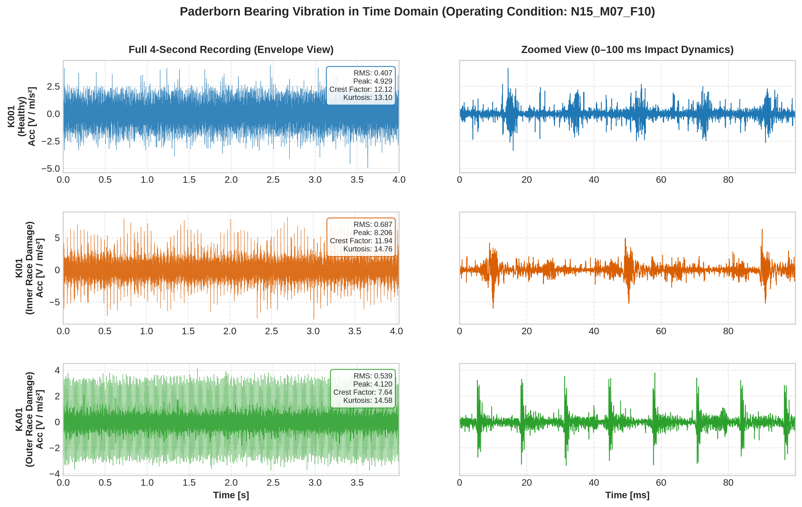
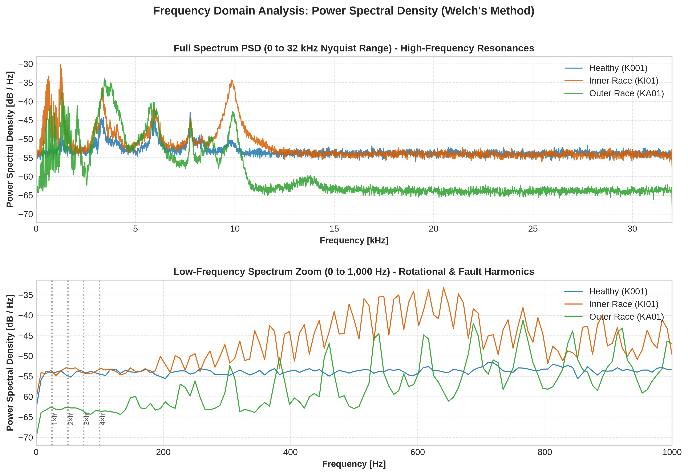
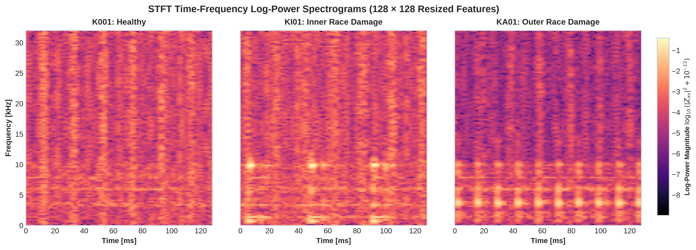
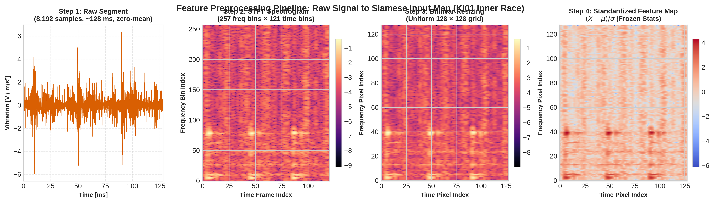
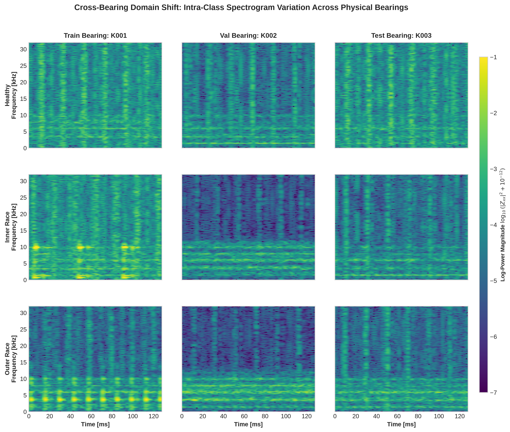
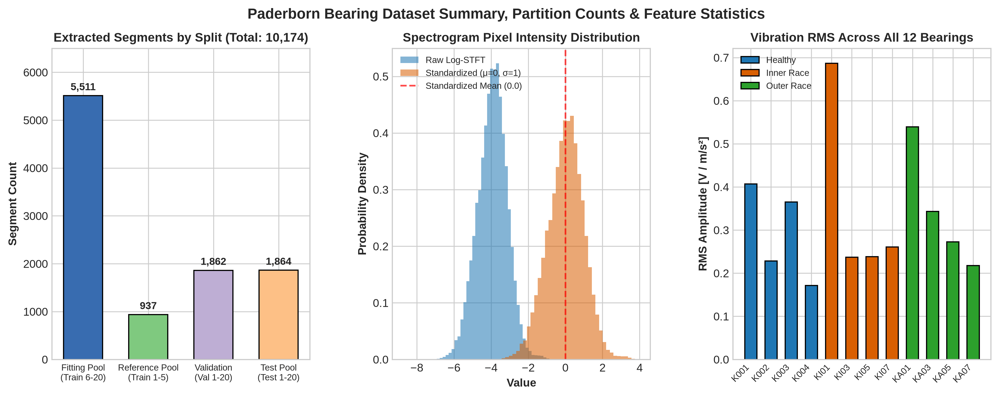

# Siamese Bearing Identification

Few-shot bearing fault identification and classification using Siamese Neural Networks on the **Paderborn University Bearing Dataset**.

---

## Overview

The objective of this project is to classify known mechanical faults (Healthy, Inner Race damage, Outer Race damage) on unseen bearings using only a few labeled reference recordings.

### Operating Condition
* **Condition Code**: `N15_M07_F10`
* **Rotational Speed**: 1,500 rpm
* **Load Torque**: 0.7 Nm
* **Radial Force**: 1,000 N
* **Sampling Rate**: 64 kHz vibration (`vibration_1` channel)
* **Duration**: 20 four-second recordings per bearing (~256,000 samples/file)

---

## Dataset Structure

The recordings are partitioned strictly across bearings as specified in the project guidelines:

| Class | Training Pool | Validation | Test |
| :--- | :--- | :--- | :--- |
| **Healthy** | `K001`, `K002` | `K003` | `K004` |
| **Inner race** | `KI01`, `KI03` | `KI05` | `KI07` |
| **Outer race** | `KA01`, `KA03` | `KA05` | `KA07` |

Directory organization in `data/raw/`:

```
data/raw/
├── train/
│   ├── K001/    # Healthy    (Files 1–5: references, 6–20: fitting)
│   ├── K002/    # Healthy    (Files 1–5: references, 6–20: fitting)
│   ├── KI01/    # Inner race (Files 1–5: references, 6–20: fitting)
│   ├── KI03/    # Inner race (Files 1–5: references, 6–20: fitting)
│   ├── KA01/    # Outer race (Files 1–5: references, 6–20: fitting)
│   └── KA03/    # Outer race (Files 1–5: references, 6–20: fitting)
├── val/
│   ├── K003/    # Healthy    (Held-out bearing, all 20 files)
│   ├── KI05/    # Inner race (Held-out bearing, all 20 files)
│   └── KA05/    # Outer race (Held-out bearing, all 20 files)
└── test/
    ├── K004/    # Healthy    (Held-out bearing, all 20 files)
    ├── KI07/    # Inner race (Held-out bearing, all 20 files)
    └── KA07/    # Outer race (Held-out bearing, all 20 files)
```

---

## Setup & Dependencies

1. **Activate the environment**:
   ```bash
   source .venv/bin/activate
   ```

2. **Install requirements** (if not already installed):
   ```bash
   pip install -r src/requirements.txt
   ```

Key dependencies:
* `torch` (with CUDA support recommended)
* `scipy`
* `numpy`
* `scikit-learn`
* `matplotlib`

---

## Preprocessing Pipeline

The preprocessing module converts raw vibration time series into standardized time-frequency representations:

1. **Segmentation**:
   * Window size: **8,192 samples** (~0.128 seconds).
   * Step size: **4,096 samples** (50% overlap) for fitting files (train files 6–20).
   * Step size: **8,192 samples** (no overlap) for references (train files 1–5) and validation/test files.
   * Trailing incomplete segments are discarded.
   * Segment mean is subtracted.

2. **STFT Spectrogram**:
   * Hann window of length **512**, overlap **448** (step 64, 87.5% overlap, no zero padding).
   * Frequency range: 0 to 32 kHz (Nyquist range, 257 bins).
   * Log-power magnitude: $\log_{10}(\text{magnitude}^2 + 10^{-12})$.
   * Resized to $(128 \times 128)$ via bilinear interpolation.

3. **Standardization**:
   * Scalar mean $\mu$ and standard deviation $\sigma$ are calculated **strictly on fitting segments**.
   * Frozen statistics are applied across all splits: $(X - \mu) / \sigma$.

### How to Run the Pipeline

Run the data pipeline directly from the repository root:

```bash
python src/data_pipeline.py
```

This will parse all 240 recordings, extract segment maps, apply frozen normalization, and output a summary of extracted segments and verified shapes.

---

## Data Visualization

A comprehensive visualization suite is provided in `src/visualize.py` to inspect raw vibrations, frequency spectra, time-frequency spectrogram representations, preprocessing pipeline steps, cross-bearing domain shifts, and dataset statistics.

### 1. Raw Time-Domain Waveforms
Comparison of vibration signals for Healthy (`K001`), Inner Race damage (`KI01`), and Outer Race damage (`KA01`). The full 4.0-second envelope is shown on the left, while a zoomed 0–100 ms window on the right details transient impact dynamics, annotated with RMS, Peak, Crest Factor, and Kurtosis.



### 2. Frequency-Domain Spectra (Power Spectral Density)
Welch's Power Spectral Density (PSD) comparing all three fault conditions. The upper plot displays the full Nyquist range (0–32 kHz) highlighting high-frequency structural resonances. The lower plot zooms into 0–1,000 Hz, marking rotational frequency ($f_r = 25\text{ Hz}$) harmonics.



### 3. STFT Time-Frequency Spectrograms
$128 \times 128$ log-power spectrograms across the 3 fault conditions showing distinct time-frequency energy patterns fed into the Siamese network.



### 4. Feature Extraction & Preprocessing Pipeline
Step-by-step transformation from raw continuous sensor data into standardized Siamese input maps:
1. Zero-mean 8,192-sample segment (~128 ms).
2. STFT log-power spectrogram ($257 \times 121$).
3. Bilinear resizing to uniform ($128 \times 128$) grid.
4. Frozen standardization $(X - \mu) / \sigma$.



### 5. Cross-Bearing Domain Shift
$3 \times 3$ spectrogram comparison illustrating inter-bearing physical variability across Train, Validation, and Test bearing units, highlighting the necessity of metric learning for few-shot identification.



### 6. Dataset Partition & Feature Statistics
Dataset breakdown illustrating segment counts per split (10,174 total: 5,511 fitting, 937 reference, 1,862 validation, 1,864 test), pixel intensity distributions before and after standardization ($\mu = -4.314, \sigma = 0.944$), and vibration RMS energy across all 12 bearing recordings.



---

### How to Run Visualizations

Generate all publication-quality figures at once:

```bash
python src/visualize.py --all
```

Or generate individual figures as needed:

```bash
# Time-domain waveforms
python src/visualize.py --waveforms

# Frequency-domain spectra (PSD)
python src/visualize.py --spectra

# STFT spectrograms
python src/visualize.py --spectrograms

# Preprocessing pipeline step-by-step
python src/visualize.py --pipeline

# Cross-bearing domain shift comparison
python src/visualize.py --cross-bearing

# Dataset partition counts & feature statistics
python src/visualize.py --stats
```

Export formats such as `--format pdf` or `--format svg` and custom resolution via `--dpi 300` are also supported.

---

## Model Architecture & Metric Learning (Progress Overview)

As preparation for the final project report, the model architectures and metric learning pipeline have been implemented in [`src/model.py`](src/model.py) and [`src/train.py`](src/train.py).

### 1. Siamese Encoder Backbone (`BearingEncoder`)
The feature extractor processes single-channel standardized STFT maps $(1 \times 128 \times 128)$ through three convolutional stages:

* **Block 1**: $\text{Conv2d}(1 \to 16, 3 \times 3, \text{padding}=1) \to \text{BatchNorm2d} \to \text{ReLU} \to \text{MaxPool2d}(2, 2)$ $\to (16 \times 64 \times 64)$
* **Block 2**: $\text{Conv2d}(16 \to 32, 3 \times 3, \text{padding}=1) \to \text{BatchNorm2d} \to \text{ReLU} \to \text{MaxPool2d}(2, 2)$ $\to (32 \times 32 \times 32)$
* **Block 3**: $\text{Conv2d}(32 \to 64, 3 \times 3, \text{padding}=1) \to \text{BatchNorm2d} \to \text{ReLU} \to \text{MaxPool2d}(2, 2)$ $\to (64 \times 16 \times 16)$
* **Global Average Pooling (GAP)**: Collapses spatial dimensions to a 64-element feature vector.
* **Projection Layer**: $\text{Linear}(64 \to 32)$.
* **Unit-Length Normalization**: $L_2$ normalization enforcing unit Euclidean length:
  $$\mathbf{e} = \frac{\mathbf{z}}{\|\mathbf{z}\|_2}, \quad \|\mathbf{e}\|_2 = 1.0$$
* **Model Size**: **25,488 parameters** (~317 KB checkpoint size).

### 2. Siamese Twin Architecture & Contrastive Loss
The Siamese model calls the shared encoder twice on input pairs $(x_1, x_2)$ to yield unit-norm representations $(\mathbf{e}_1, \mathbf{e}_2)$.

The network is optimized using **Contrastive Loss** with margin $m = 1.0$:
$$L(\mathbf{e}_1, \mathbf{e}_2, y) = \frac{1}{2} y D^2 + \frac{1}{2} (1 - y) \max(0, 1.0 - D)^2$$
where:
* $D = \|\mathbf{e}_1 - \mathbf{e}_2\|_2$ is the Euclidean distance between embeddings.
* $y = 1$ denotes a **matching pair** (same fault class): pulls embeddings together toward $D = 0$.
* $y = 0$ denotes a **non-matching pair** (different fault classes): repels embeddings apart beyond the margin $D \ge 1.0$.

### 3. Balanced Pair Generation (`BalancedPairDataset`)
* **Strict Split Hygiene**: Reference recordings (files 1–5) and held-out validation/test bearings **never** enter training pairs.
* **Balanced Sampling**: Pairs are sampled exclusively from fitting segments (files 6–20 of training bearings `K001, K002, KI01, KI03, KA01, KA03`).
* **50/50 Balance**: Exactly 50% positive and 50% negative pairs, distributed uniformly across the three fault classes and six training bearings.

### 4. Baseline Classifier for Fair Comparison (`BaselineClassifier`)
* Employs the identical 3-block convolutional encoder backbone.
* Replaces the Siamese metric projection with a 3-class linear head ($\text{Linear}(32 \to 3)$), totaling 25,587 parameters.
* Optimized via Cross-Entropy Loss on the same fitting pool under the exact same budget (30 epochs, Adam lr=0.001, batch size 32) to serve as an empirical benchmark against few-shot metric learning.


